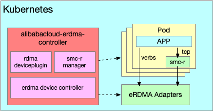

# alibabacloud-erdma-controller
Kubernetes controller for alibabacloud erdma resource

## Description
Dynamic configure erdma devices on kubernetes nodes, and automatically inject erdma-accelerated networks for Kubernetes Pods.



## Getting Started

### Prerequisites
- helm
- Kubernetes Cluster With AlibabaCloud ECS Nodes
- AlibabaCloud Linux 3 with Kernel Version >= 5.10.134-17

### To Deploy on the cluster
#### create & authorize ram role&policy
alibabacloud-erdma-controller need following permissions:
```json
{
  "Version": "1",
  "Statement": [
    {
      "Action": [
        "ecs:DescribeInstances",
        "ecs:DescribeInstanceTypes",
        "ecs:DescribeNetworkInterfaces",
        "ecs:ModifyNetworkInterfaceAttribute",
        "ecs:CreateNetworkInterface",
        "ecs:AttachNetworkInterface",
        "ecs:TagResources"
      ],
      "Resource": [
        "*"
      ],
      "Effect": "Allow"
    }
  ]
}
```
#### prepare configuration
prepare a values.yaml file with the following content to authorize controller to access erdma API:
##### use rrsa authorization
```yaml
credentials:
  type: "oidc_role_arn"
serviceAccount:
  annotations:
    pod-identity.alibabacloud.com/role-name: {your-ram-role-name}
```
*need config rrsa components on ACK, [refer doc.](https://help.aliyun.com/zh/ack/ack-managed-and-ack-dedicated/user-guide/use-rrsa-to-authorize-pods-to-access-different-cloud-services)*

##### use access_key authorization
```yaml
credentials:
  type: "access_key"
  accessKeyID: "{access key}"
  accessKeySecret: "{access key secret}"
```
#### Lingjun nodes with eRDMA

Lingjun nodes with preconfigured RDMA ENIs are discovered separately from
ECS instances. Nodes are identified by `alibabacloud.com/lingjun-worker=true`, or
by an `e01-*` providerID equal to the node name when that label is absent. The
controller queries existing ENIs using the node name as the instance ID and
selects only attached `HighPerformance` ENIs without querying ECS instance
capacity or jumbo-frame settings. Nodes without eligible ENIs do not receive an
ERdmaDevice resource. Once created, the resource uses the same ENI reconciliation
as ECS: configured ENIs become Ready; abnormal ENIs use the existing attach and
configuration handling.

Selected ENIs receive the existing Terway exclusion and instance-id tags,
including backfill for existing ERdmaDevice resources. No creator tag is added
to platform-provisioned ENIs.

The agent uses the existing driver setup flow on Lingjun as on ECS: reuse an
installed driver or install it when missing, then apply the selected profile's
module configuration. ENI MAC/GUID-based discovery excludes tail-network RDMA
devices. Existing agent affinity and tolerations must allow the target nodes.

RDMA devices are selected through their association with the ENI's netdev,
independently of RDMA device names (including `mlx5_*`). Tail-network devices
associated with other netdevs are excluded. No RDMA namespace-isolation policy or tail-network driver is
modified. `localERIDiscovery` remains a separate, cluster-wide option.

Cross-node verbs communication has been verified with `hostNetwork: true`.
On the tested preinstalled driver, ordinary Pod network namespaces expose zero
GIDs and perftest fails when moving the QP to RTR. Device injection alone does
not make that networking mode usable; it requires separate driver/network
integration validation.

Device discovery selects only ENI-associated RDMA devices. Pods receive
individual matching `uverbsN` devices and, when required, `rdma_cm`; neither
`/dev` nor `/dev/infiniband` is mounted as a directory. `allocateAllDevices`
exposes all discovered eRDMA devices, not all RDMA devices on the host.

#### localERIDiscovery mode
To expose existing erdma devices on the node to pods, enable `localERIDiscovery` configuration in values.yaml. This eliminates the need to create and authorize ram roles and policies according to the above steps for accessing the erdma API.
##### expose specified erdma devices on each node
`exposedLocalERIs` field in values.yaml defines which erdma devices are exposed per node. For example:
```yaml
exposedLocalERIs:
  - i-XXX erdma_0/erdma_1 # specify instance ID and erdma devices(erdma_0/erdma_1) to expose
  - i-* erdma_0           # specify erdma devices(erdma_0) to expose for all unspecified nodes
  - i-* erdma_*           # expose all existing erdma devices for all unspecified nodes
```
#### helm install
```sh
helm install -f values.yaml --namespace kube-system alibaba-erdma-controller deploy/helm/
```

#### check status
##### check pods
```sh
kubectl get pod -n kube-system | grep erdma
```
##### check erdma devices
```sh
kubectl get erdmadevices
```
##### check device plugin
```sh
kubectl get node -o yaml | grep aliyun/erdma
```

### Using ERDMA Accelerated Network
#### Pod Configurations to Enable ERDMA Accelerated Network
* add `aliyun/erdma` resource in pod spec # config erdma devices for pod
* `network.alibabacloud.com/erdma-smcr: "true"` # config smcr for pod, dynamicially replace tcp connection to erdma, need `network.alibabacloud.com/erdma` enabled first.

#### Example
```yaml
apiVersion: apps/v1
kind: Deployment
metadata:
  labels:
    app: erdma
  name: erdma
spec:
  replicas: 1
  selector:
    matchLabels:
      app: erdma
  template:
    metadata:
      labels:
        app: erdma
      annotations:
        network.alibabacloud.com/erdma-smcr: "true"
    spec:
      containers:
      - command:
        - sleep
        - "360000"
        image: registry.aliyuncs.com/wangbs/netdia:latest
        name: erdma
        resources:
          limits:
            aliyun/erdma: 1
```

### To Uninstall
uninstall helm
```sh
helm -n kube-system uninstall alibaba-erdma-controller 
```

## Build
### Build Controller
```sh
docker build --tag registry.aliyuncs.com/erdma/controller:latest --target controller .
```
### Build Agent
```sh
docker build --tag registry.aliyuncs.com/erdma/agent:latest --target agent .
```
### Build SMCR_INIT
```sh
docker build --tag registry.aliyuncs.com/erdma/smcr_init:latest --target smcr_init .
```

## License

Copyright 2024.

Licensed under the Apache License, Version 2.0 (the "License");
you may not use this file except in compliance with the License.
You may obtain a copy of the License at

```text
http://www.apache.org/licenses/LICENSE-2.0
```

Unless required by applicable law or agreed to in writing, software
distributed under the License is distributed on an "AS IS" BASIS,
WITHOUT WARRANTIES OR CONDITIONS OF ANY KIND, either express or implied.
See the License for the specific language governing permissions and
limitations under the License.

